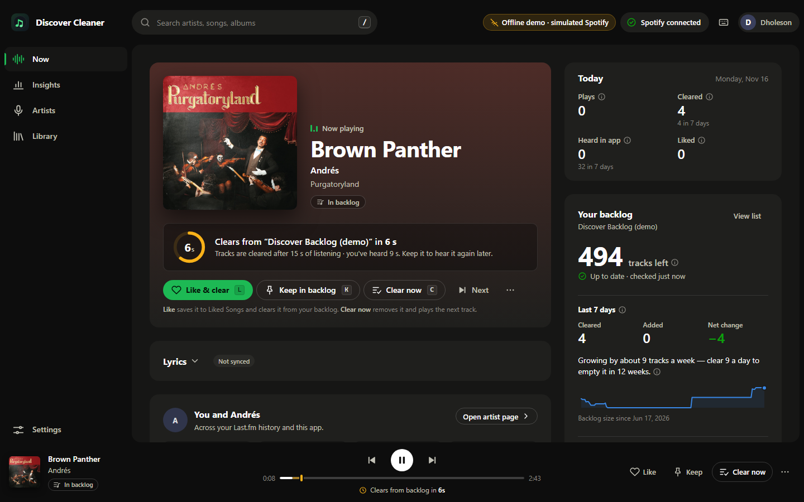
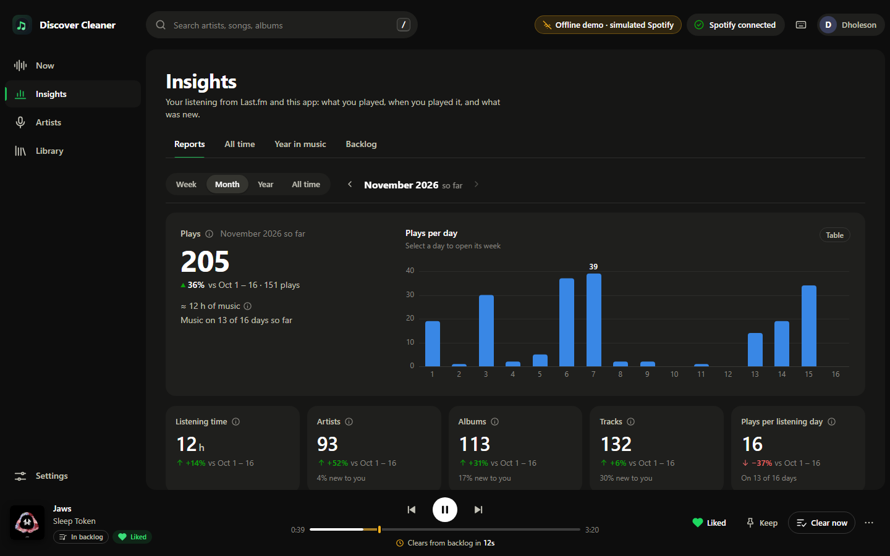
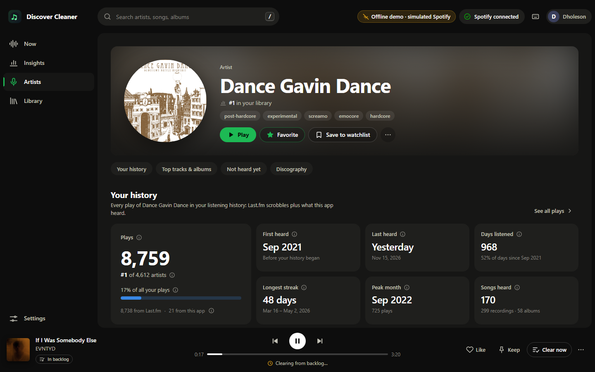
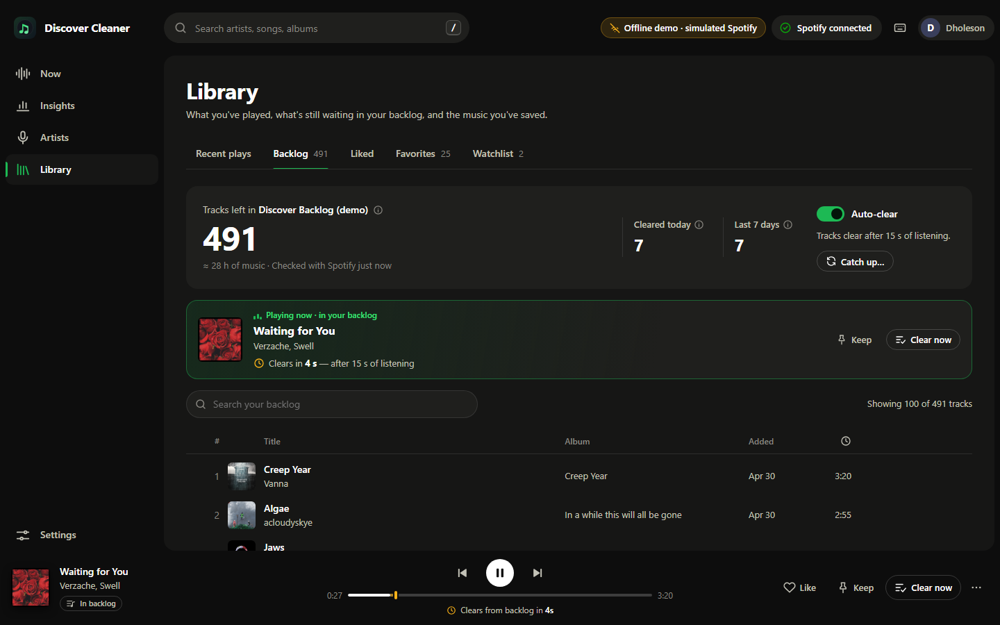
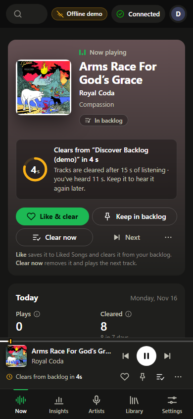

# Discover Cleaner

A local companion for Spotify and Last.fm that does three jobs:

1. **Clears your "to listen" backlog as you listen.** Point it at a playlist, for example the one
   your Discover Weekly finds pile up in. Once a track from that playlist has really played for a
   few seconds, it is removed from the playlist, so the backlog shrinks by itself. You always see
   what will happen to the current track and when, and you can **keep** it, **clear it now**,
   **like** it, or **undo** a clear.
2. **Shows you your listening like Last.fm Pro.** Reports for any week, month, year or all time,
   built from your full Last.fm history plus what the app hears: top artists, albums and tracks
   with change against the previous period, how much was new, your listening clock and weekly
   rhythm, streaks, discoveries that stuck, obsessions, artists to rediscover, and a "year in
   music" page.
3. **Gives every artist a personal page.** Your plays, rank, first and last listen, plays per
   year, your top tracks and albums, what you haven't heard yet, how much of their discography
   you've explored, and similar artists with your own play counts next to them.

It runs on your computer at <http://127.0.0.1:8888>. Your history lives in a local SQLite file.



| Insights report | Artist page |
|---|---|
|  |  |
| **Library: the backlog** | **On a phone** |
|  |  |

The screenshots come from the offline demo below: the listening history is the author's own.

## Try it

### The live demo

**<https://dhole.dev/projects/discover-cleaner>** runs the interface in your browser with the
author's listening history and a simulated Spotify. Nothing to install, nothing to sign in to.

### Offline, in about a minute

Runs the whole app on your computer with a simulated Spotify, so you need neither a Spotify
account nor Premium. You need [Python 3.10 or newer](https://www.python.org/downloads/).

```
git clone https://github.com/Dholeson/spotify-discover-cleaner.git
cd spotify-discover-cleaner
run.bat --demo          # Windows
./run.sh --demo         # macOS / Linux
```

Then open <http://127.0.0.1:8888>. A badge in the top bar says **Offline demo · simulated
Spotify**. Tracks "play" for 40 seconds each, and the ones from the backlog clear after the
listening threshold, exactly as with the real thing. Like, keep, clear, undo and the settings all
work, and the app never talks to Spotify in this mode (it blocks every request to it). Online,
album covers still load from Spotify's image server and lyrics from LRCLIB.

- The demo keeps its data in `.demo-data/`, apart from a real install. `--demo --reset` starts over.
- Its history is the author's real Last.fm history and app plays, **frozen on 2026-10-04**
  (see [demo/README.md](demo/README.md)). On first start the dates move forward by whole weeks so
  the history ends in the current week; weekdays stay the same.
- Without the scripts: `python -m venv .venv`, activate it, `pip install -r requirements.txt`,
  then `python app.py --demo`.

## Use it with your Spotify

What you need, because of how Spotify's developer platform works since February 2026:

- **Spotify Premium** for the account that creates the developer app (Spotify's rule). Without
  it, Spotify answers every request with "Active premium subscription required for the owner of
  the app".
- **Your own Spotify app** (free, about five minutes). Everyone runs their own copy of Discover
  Cleaner with their own app. An app in Development Mode works for **you plus up to 5 people** you
  add under *User Management* in the dashboard, so friends can either be added to yours or create
  their own. (A public, sign-in-with-Spotify website isn't possible: Spotify only grants that
  access to registered businesses with 250,000+ monthly users. That's why the live demo is
  simulated.)

Then:

1. Start the app: double-click `run.bat` (Windows) or run `./run.sh` (macOS/Linux). The first run
   creates a virtual environment and installs the three dependencies (Flask, spotipy,
   python-dotenv); later runs reinstall only when `requirements.txt` changes.
2. Open <http://127.0.0.1:8888>. Without credentials the app shows a **Setup** screen that walks
   you through it:
   - create an app at <https://developer.spotify.com/dashboard>,
   - add the Redirect URI it shows, exactly: `http://127.0.0.1:8888/callback` (there's a copy
     button), tick **Web API**, and save,
   - paste the app's **Client ID** and **Client Secret**, and optionally your Last.fm key and
     username. **Save** writes them to `.env` next to `app.py`.
3. Click **Connect Spotify**, allow access, and you're back in the app.
4. **Pick your backlog playlist**: one you own or collaborate on (Spotify only lets an app change
   those). Clearing starts with the next track you play from it.

You can also skip the Setup screen: copy `.env.example` to `.env` and fill it in. Every setting is
explained there, and most can be changed later under **Settings**.

Options: `--port N` serves on another port (the default Redirect URI follows it, so register
`http://127.0.0.1:N/callback`). `DISCOVER_DATA_DIR` in `.env` or the environment moves the
database, app state, sign-in cache and backups to another folder.

The app needs **spotipy 2.26 or newer** (`requirements.txt` asks for it): older versions call
`/playlists/{id}/tracks` and `/me/tracks/contains`, which Spotify apps created after 2026-02-11
no longer have. For the same reason leave `SPOTIFY_EXTENDED_ENDPOINTS` off unless your Spotify app
was created before that date.

### Last.fm (optional, recommended)

Get a free API key at <https://www.last.fm/api/account/create> (any application name) and enter it
with your username on the Setup screen or under Settings. Your whole scrobble history is then
imported, kept in sync every 30 minutes, and used for reports and artist pages; artist pages also
get bios, tags and similar artists. Without Last.fm, history starts with what the app hears.

### Upgrading

On the first start after an upgrade the app updates its database automatically. Before each
upgrade step it saves a full copy next to it (`music_explorer.db.bak-v2`, ...) and never deletes
those copies. It then builds its listening ledger in the background (a few seconds) and starts the
Last.fm sync; until the ledger is ready, Insights and artist pages show a short "getting your
history ready" note.

## Using it

### Now
What's playing and what happens to it. The panel under the track says one of:

| You see | Meaning |
|---|---|
| **Clears from "…" in 7 s** | The track is in your backlog and will be removed after the listening threshold. |
| **Cleared · Undo** | Removed. Undo puts it back at its old position (for 30 minutes). |
| **Keeping this one** | You pressed Keep: it stays in the backlog this time. |
| **Auto-clear is paused** | The Auto-clear switch is off; nothing is removed automatically. |
| **Not in your backlog** | Nothing will be removed. |
| **Checking your backlog** | The app is still reading the playlist; nothing is removed until it knows for sure. |
| **Couldn't clear yet** | Spotify was busy; the removal is retried automatically. |

Buttons: **Like** (saves it to Liked Songs and clears it), **Keep in backlog**, **Clear now** (clears
and skips to the next track), **Next**. Also on this page: today's numbers, the backlog size with
how fast it is growing or shrinking and when it would be empty at your pace, recently cleared
tracks (with undo), a "catch up" helper for backlog tracks you already heard elsewhere, synced
lyrics, and a short "you and this artist" card.

### How clearing works
A track is cleared once per play, after it has really played for the threshold (15–30 s by
default, adjustable on the Now page and in Settings; never more than 80% of a short track).
Pausing stops the count, seeking forward doesn't add time, and only tracks the app has confirmed
are in the playlist are ever removed: while it is still reading the playlist, nothing is cleared.
Clearing happens whenever the app is running and **Auto-clear** is on (the switch pauses it), on
whatever device you play. A removal Spotify refuses is queued and retried; **Undo** puts a track
back at its old position for 30 minutes.

### Insights
- **Reports**: pick Week, Month, Year or All time and step back through time with the arrows.
  Plays, listening time, artists, albums and tracks (with how many were new to you), top lists with
  change against the previous period (**NEW** = first time ever, **BACK** = returning after a
  break), your listening clock, weekday rhythm, quick facts and the artists you discovered. For a
  period that is still running, the comparison uses the same number of days of the previous period.
- **All time**: five years at a glance: plays per year, streaks, how concentrated your taste is,
  discoveries and how many stuck, obsessions, and artists you loved but haven't played in a while.
- **Year in music**: a summary card for any year.
- **Backlog**: how the backlog grew and shrank, how many tracks come in and go out per week, how
  much of what you clear you actually listen to past the threshold, and which genres land for you.

Every number has an ⓘ explaining exactly what it counts. If your Last.fm history is behind, a
banner says so instead of showing a fake drop. Podcasts or other non-music "artists" can be hidden
from all stats from their artist page (**Hide from stats**).

### Artists
Search or browse all your artists (`#/artists`), or click any artist name anywhere. The artist page
shows your history first (it's instant), then fills in Spotify and Last.fm details.

### Library
Recent plays (back to the beginning of your history), the backlog itself (searchable, with
clear/undo), Liked Songs, favorite artists with a new-release radar, and a **Watchlist** of tracks,
artists and albums you want to come back to (with reasons and notes).

### Settings
Which playlist is the backlog, auto-clear and threshold, Spotify and Last.fm accounts, history sync
and data health (how current your history is, backups), connection status and diagnostics, and
advanced settings. Secrets are never shown back to the browser.

### Keyboard shortcuts
`space` play/pause · `n` / `p` next/previous · `l` like · `k` keep · `c` clear now · `u` undo last
clear · `/` search · `g` then `n` `i` `a` `l` `s` to jump to Now, Insights, Artists, Library,
Settings · `?` shows all shortcuts.

### The old interface
The previous single-page interface is still available at <http://127.0.0.1:8888/classic>, and the
pop-out mini player at `/widget` (also reachable from Settings).

## Privacy

Everything stays on your computer. The app talks only to Spotify (with your own developer app),
Last.fm (if you add a key) and LRCLIB (for lyrics), straight from your machine; there is no
server of ours in between and no analytics. Your credentials stay in `.env`, your sign-in in
`.spotify_cache`, your history in `music_explorer.db` and app state in `.config.json`: all in the
app folder (or `DISCOVER_DATA_DIR`), all ignored by git. The server only answers on 127.0.0.1 /
localhost and refuses requests from other websites. Settings never send secrets back to the page.

## Troubleshooting

- **The status pill says "Rate limited"**: Spotify asked the app to slow down. The pill shows how
  long, and what still works meanwhile (insights, history, artist pages from local data, lyrics).
  The app waits it out on its own.
- **"INVALID_CLIENT: Invalid redirect URI"**: the Redirect URI in your Spotify dashboard must be
  exactly the one the Setup screen shows, `http://127.0.0.1:8888/callback` by default (http, no
  trailing slash, 127.0.0.1 rather than localhost).
- **"Active premium subscription required for the owner of the app"**: the account that created
  the Spotify app needs Premium. Upgrade it, or create the app with a Premium account and save the
  new keys under Settings.
- **"Spotify rejected this account for the app"**: in Development Mode only the app's owner and the
  people added under *User Management* (up to 5) can sign in.
- **Nothing is being cleared**: check the panel under the track: it tells you why (not in the
  backlog, auto-clear paused, still checking the playlist, Spotify busy). The playlist must be yours
  or collaborative.
- **Insights stop at some date**: open Settings → History & data and press **Sync now**.
- **"insufficient client scope"**: delete `.spotify_cache` and connect again.

## How it's built

A Flask server (`app.py` plus `src/`) and a dependency-free ES-module interface (`static/js`), with
SQLite for history. The server polls Spotify playback every few seconds; a **plays ledger** merges
Last.fm scrobbles and live plays into one row per listen for every report; a **clearing engine**
counts real listening time and removes each backlog track at most once per play, never while
playlist membership is unknown; and a **Spotify guard** paces, caches and de-duplicates every API
call so the app stays inside Spotify's rate limits. Details: [docs/ARCHITECTURE.md](docs/ARCHITECTURE.md).

```
app.py               server: Spotify sign-in + guard, playback polling, settings, setup, legacy routes
src/persistence/     SQLite: schema + migrations (db.py), event log, the plays ledger (plays.py)
src/services/        backlog index + clearing engine, reports, artist stats, discography, importers
src/web/             the /api/v2 endpoints used by the interface (one blueprint per area)
src/devtools/        the simulated Spotify (fake_spotify.py) and the offline demo mode (demo.py)
templates/, static/  the interface (index.html + ES modules in static/js, styles in static/css)
                     and the old interface (classic.html, static/classic/)
demo/snapshot/       the offline demo's data; dev/make_snapshot.py builds it
tests/               unit and integration tests (stdlib unittest)
```

## Development

```
.venv/Scripts/python.exe -m unittest discover -s tests     # Windows
.venv/bin/python -m unittest discover -s tests             # macOS / Linux
```

The tests never touch your data or the network: the integration tests run on a temporary copy of
the app with a fake `.env` and every outgoing request blocked.

`python app.py --demo` is also the development sandbox: the real poll loop, clearing engine and
interface against the simulated Spotify in `src/devtools/fake_spotify.py`, with its data in
`.demo-data/`. Environment knobs: `FAKE_TRACK_SECONDS` (seconds each simulated track plays,
default 40), `FAKE_PL_SIZE` (pad the simulated playlist to this many tracks), `FAKE_API_MODE=2026`
(behave like a Spotify app created after 2026-02-11), `DISCOVER_DEMO_DIR` (where the demo keeps
its data). `APP_DEBUG=1` / `APP_USE_RELOADER=1` in `.env` turn on Flask's debugger and reloader;
never use them while other people can reach your computer.

## License

[MIT](LICENSE)
